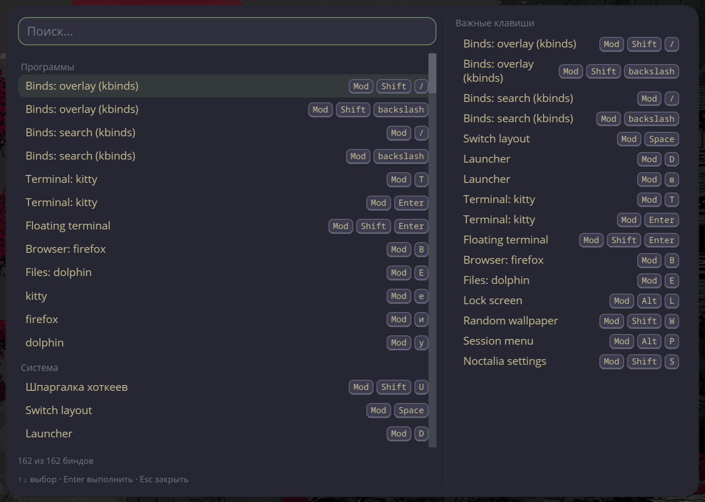

# kbinds

Interactive keybind cheatsheet for the [niri](https://github.com/YaLTeR/niri) Wayland compositor.

`kbinds` parses the `binds {}` section of your niri config (`~/.config/niri/config.kdl` — niri's IPC doesn't expose binds) and gives you four ways to use it:

- **`overlay`** — center-screen overlay (layer-shell): search field, grouped binds with keycaps, and a static cheat-sheet of important keys on the right. Navigate with `↑ ↓ / Enter / Esc` or the mouse.
- **`dmenu`** — search and execute binds through fuzzel.
- **`list --json`** — machine-readable bind list for scripts and integrations.
- **`audit`** — finds conflicting combos (niri rejects the whole config on duplicates), binds invisible to niri's default hotkey overlay, and common actions with no bind.



## Install

From [releases](https://github.com/ys-kalyakin/niri-kbinds/releases):

```bash
tar xzf niri-kbinds-v0.1.0-x86_64-linux-gnu.tar.gz
cp kbinds kbinds-overlay ~/.local/bin/
```

From source: `cargo install --path .` (Rust stable, no system dependencies — installs `kbinds` and `kbinds-overlay`).

## Setup

Add to `config.kdl`:

```kdl
binds {
    Mod+Shift+Slash     hotkey-overlay-title="Binds: overlay" { spawn "kbinds" "overlay"; }
    Mod+Shift+backslash hotkey-overlay-title="Binds: overlay" { spawn "kbinds" "overlay"; }
    Mod+Slash           hotkey-overlay-title="Binds: search"  { spawn "kbinds" "dmenu"; }
    Mod+backslash       hotkey-overlay-title="Binds: search"  { spawn "kbinds" "dmenu"; }
}
```

The `Slash`+`backslash` pair covers both keyboard layouts; `Mod+Shift+/` is taken by niri's default hotkey overlay and must be moved elsewhere. Binds with `hotkey-overlay-title` appear in the overlay's cheat-sheet column.

## Commands

```
kbinds list [--json] [--config PATH]
kbinds exec <id> [--dry-run] [--config PATH]
kbinds dmenu [--launcher fuzzel] [--config PATH]
kbinds overlay [--dry-run] [--mode center] [--config PATH]
kbinds audit [--json] [--strict] [--config PATH]
```

`audit --strict` exits with code 1 when errors are found. The overlay UI follows the system locale (ru/en) and the noctalia theme palette via `~/.cache/kbinds/theme.json` (a built-in fallback palette is used when it's absent).

## Development

```bash
cargo test && cargo clippy -- -D warnings && cargo fmt --check
```

License: [MIT](LICENSE).
